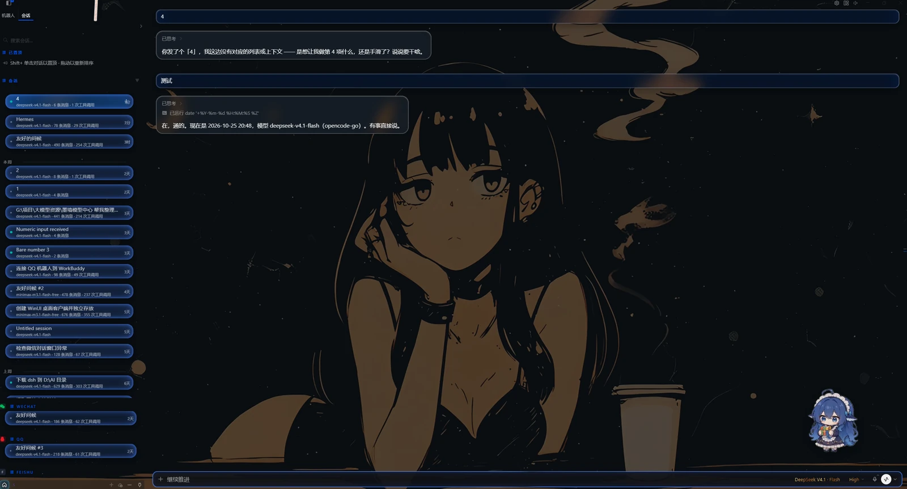
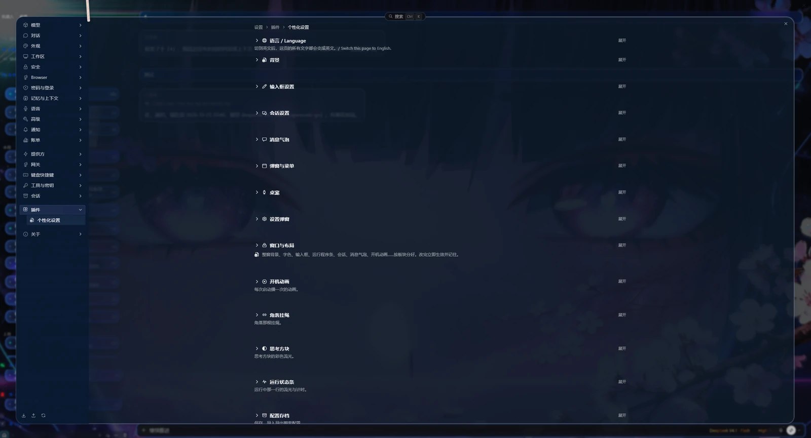
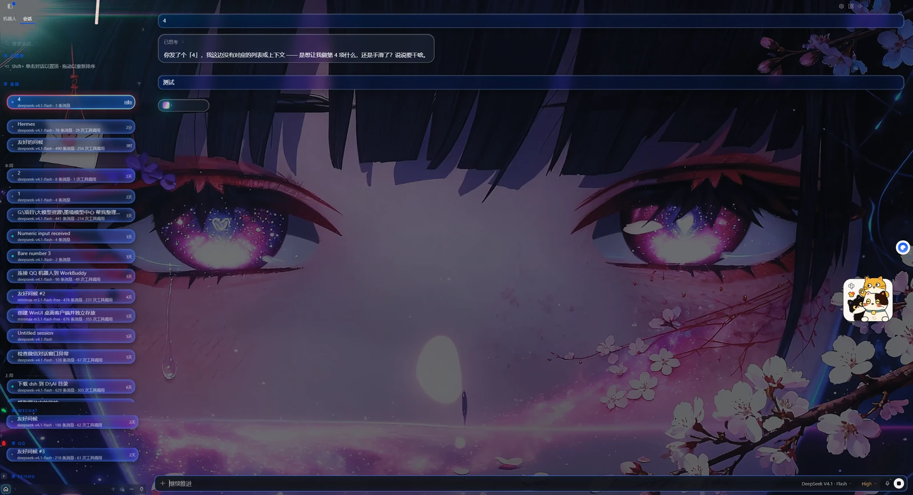

# Hermes 个性化外观插件 (Hermes Appearance Plugin)

给 Hermes 桌面端换一张脸的插件：自定义背景、字体、玻璃磨砂、消息气泡、桌宠、开机动画……
它是一个**单文件插件**，直接跑在 Hermes 的插件层里，**不改源码、Hermes 升级也不会失效**。

An appearance plugin for the Hermes desktop app: custom background, fonts, frosted glass,
message bubbles, desktop pet, startup animation and more. It is a **single-file plugin** that
runs in Hermes' plugin layer — **no source patching, survives Hermes updates**.

---

## 截图 / Screenshots

*对话界面：背景图 + 玻璃气泡 + 右侧桌宠*

*个性化设置页，最上面是「语言 / Language」，下面按「地方」分组*

*同一段对话换一张壁纸：背景、气泡、桌宠各自独立生效*

---

## 安装 / Install

1. 打开 Hermes 桌面端，按 `Ctrl+K`，输入 `plugins` 回车（或者从设置里进「插件」）。
2. 新建一个插件，把本仓库的 `plugin.js` 放进该插件的文件夹。
   默认位置：`%LOCALAPPDATA%\hermes\desktop-plugins\<插件名>\plugin.js`
3. 按 `Ctrl+K` → `reload` → 回车，让 Hermes 重新加载。
4. 进「设置 → 插件 → 个性化设置」，最上面有「语言 / Language」，可以切中文或英文。

1. Open Hermes Desktop, press `Ctrl+K`, type `reload` and hit Enter after installing.
2. Put `plugin.js` into `%LOCALAPPDATA%\hermes\desktop-plugins\<your-plugin-folder>\plugin.js`
3. Press `Ctrl+K` → `reload` → Enter.
4. Go to **Settings → Plugins → Appearance** and pick 中文 or English at the top.

> 插件不热加载：**改文件后必须 `reload` 一次**，只加载新文件夹不加载文件改动。
> The plugin does not hot-reload — always `reload` after changing files.

## 开箱即用 / Works out of the box

装完不用配任何路径就能用：

- 右上角的挂绳、鼠标指针、桌宠动画的贴图都**内联在代码里**，不依赖任何本机文件
- 每个功能都有独立开关，默认值都设成「关掉后不留痕迹」（不影响原版外观）
- 桌宠素材是可选的：不选就是没有桌宠，**不会报错**
- 所有设置都存在本机，不进任何网络请求

Nothing needs configuring after install. Assets (rope, cursors, pet sprites) are embedded in
`plugin.js` — no local paths required. Every feature degrades gracefully when its optional
asset (e.g. a pet clip pack) is missing.

## 功能 / Features

- 背景：图片 / 视频 / 纯色，缩放、模糊、遮罩、随窗口自动铺满
- 字体：界面字体、等宽字体、字重、文字颜色
- 玻璃与磨砂：输入框、消息气泡、会话卡片、弹窗、右键菜单各自独立配方（模糊、饱和度、圆角、内发光）
- 消息气泡：圆角、内缩、对齐方式（靠左/居中/靠右）、尾巴、透明度
- 会话列表：选中反光、鼠标悬浮漂浮、拖动改宽
- 开工动画、欢迎页、桌宠（可换宠物包、点击音效、DeepSeek 余额显示）
- 鼠标指针：10 组以上自绘指针，多形态
- 所有设置支持**导出 / 导入配置包**（不含任何密钥）

## 可选素材 / Optional assets

| 素材 | 放哪 | 说明 |
|---|---|---|
| 背景图 / 视频 / 音乐 | 插件设置里选文件即可 | 支持 mp4 / webm / jpg / png / mp3 |
| 桌宠包 | 「宠物包 → 选择宠物包文件夹」 | 目录下每个子目录 = 一个宠物包，里面放 webm 动画 |

桌宠包的 **webm 动画不在本仓库内**（版权原因）。你可以在设置里指向任意自备的 webm 目录。

## 兼容性 / Compatibility

- Hermes 桌面端（Windows 11 实测；macOS / Linux 未测）
- 不修改 Hermes 源码，不改 `apps/desktop`
- 卸载 / 回滚：删除插件文件夹，或 `hermes config set display.skin default`

## 许可 / License

MIT，见 [LICENSE](LICENSE)。

内联素材（挂绳、自绘鼠标指针）由本项目作者制作。桌宠动画素材需自备。

## 交流 / Community

有问题、想聊更新或交流心得，欢迎加 QQ 群：**1047829560**

Issues and pull requests are welcome.
